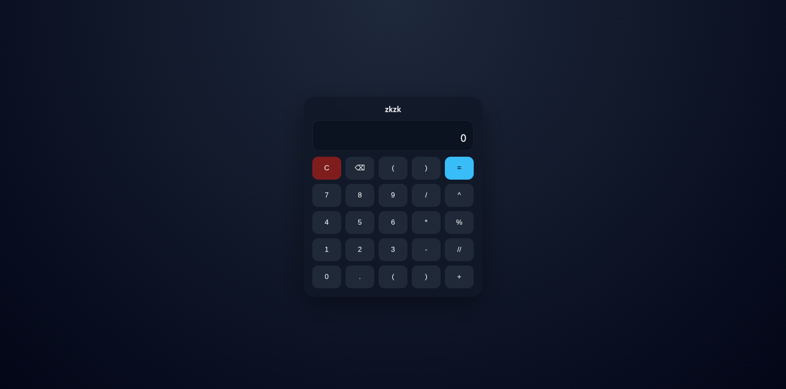
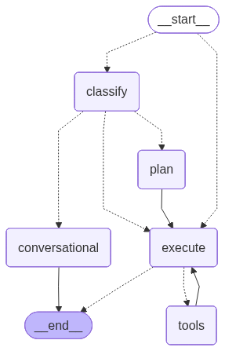
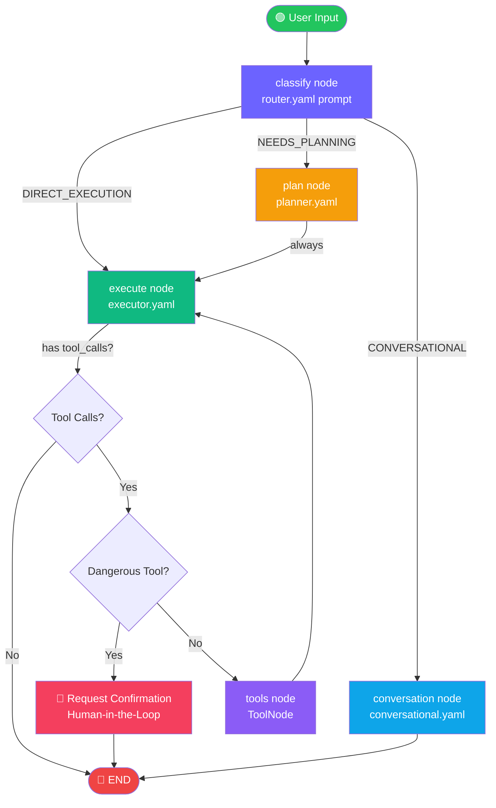

# 🤖 zkzkAgent — Intelligent Local AI System Manager for Linux

<div align="center">


k


**A privacy-first AI agent for Linux that thinks before it acts — built with LangGraph's multi-node router architecture. Runs fully local with Ollama, or on decentralized GPUs with Nosana.**

</div>

This repository implements a multi-node LangGraph/StateGraph runtime that mirrors the routing, state management, and tool-gating patterns I build in production. The architecture maps directly to systems I developed at Alohadot and ThePost, including multi-agent orchestration and LLM routing across vLLM/SGLang/OpenAI/Gemini. Use this local runtime to prototype and validate production-grade agent behaviors on Linux.

> ⚠️ **Linux Only**: Designed for Linux (Ubuntu/Debian-based). Uses Linux-specific tools like `nmcli`, `xdg-open`, and system paths.

> 🆕 **Now on Nosana**: set `MODEL_TYPE=NOSANA` and the agent's LLM runs on [Nosana](https://nosana.com)'s decentralized GPU network, so even a small laptop can drive a 27B model. Tools still run on your machine. See [Nosana Decentralized GPU Inference](#-nosana-decentralized-gpu-inference-new) and a [real run](#-real-run-on-nosana-zkzkagent-builds-a-calculator-app), whose code is on GitHub at [zkzkGamal/calculator](https://github.com/zkzkGamal/calculator).

---

## 🎬 Demos

<div align="center">
  <a href="https://www.youtube.com/shorts/eC5XbqPbzSY">
    
  </a>
  <br/><em>Demo Video 1</em>
  <br/><br/>
  <a href="https://www.youtube.com/shorts/D0dmyMQFHUs">
    
  </a>
  <br/><em>Demo Video 2</em>
</div>

---

## 📑 Table of Contents

- [✨ Key Features](#-key-features)
- [🌐 Nosana Decentralized GPU Inference (New)](#-nosana-decentralized-gpu-inference-new)
- [🧪 Real Run on Nosana](#-real-run-on-nosana-zkzkagent-builds-a-calculator-app)
- [🏗️ Architecture — Router & Conditional Branching](#️-architecture--router--conditional-branching)
- [🚀 Quick Install](#-quick-install)
- [🚀 Getting Started](#-getting-started)
- [💻 Usage](#-usage)
- [📖 Usage Examples](#-usage-examples)
- [📂 Project Structure](#-project-structure)
- [🔧 Advanced Configuration](#-advanced-configuration)
- [🐛 Troubleshooting](#-troubleshooting)
- [📊 Performance Tips](#-performance-tips)
- [🔒 Security](#-security)
- [🤝 Contributing](#-contributing)
- [📄 License](#-license)

---

## ✨ Key Features

### 🧠 Smart Multi-Path Reasoning (New Architecture)

zkzkAgent doesn't just blindly execute your commands — it **classifies your intent first**, then picks the optimal execution path:

- **Conversational Path**: Direct answers to questions with no tool overhead
- **Direct Execution Path**: Immediate tool dispatch for clear, single-step tasks
- **Planning Path**: Multi-step task decomposition before execution — catches hidden dependencies

### 🌐 Decentralized GPU Inference (New)

- **Nosana Backend**: Set `MODEL_TYPE=NOSANA` to run the agent's LLM on Nosana's decentralized GPU network — bigger models (we use a 27B Qwen) on any laptop
- **Same Agent, Same Tools**: The router, planner, confirmation gates and all 25 tools still run locally; only the model calls go to Nosana
- **One-File GPU Job**: `nosana-ollama.json` deploys your own Ollama server on a Nosana GPU

### ⚡ Intelligent Automation

- **Background Deployment**: Run long-running scripts in the background with AI-assisted option selection
- **Process Management**: Track, monitor, and terminate background processes via chat
- **Smart File Search**: Automatic wildcard matching when exact filenames aren't found
- **Real-time Streaming**: Token-by-token response streaming for instant feedback
- **Low-latency Startup**: Adaptive warm-up ensures the agent is ready when you are

### 🌐 Network Awareness

- **Auto-Connectivity Check**: Verifies internet access before any network-dependent task
- **Self-Healing Wi-Fi**: Detects disconnections and auto-enables Wi-Fi via `nmcli`

### 🛡️ Human-in-the-Loop Safety

- **Confirmation Gates**: Destructive operations require explicit `yes/no` before execution
- **Dangerous Tool Protection**: Safeguards for `empty_trash`, `remove_file`, `install_package`, and more
- **Local Execution**: Tools always run on your machine; with Ollama, inference does too and nothing leaves it

### 🎤 Voice Interaction (Optional)

- **Voice Input**: Whisper-based speech recognition with Voice Activity Detection (VAD)
- **Text-to-Speech**: Natural voice responses via Coqui TTS / Kokoro
- **Noise Reduction**: Built-in audio preprocessing for accurate recognition

### 🛠️ Comprehensive Tooling (25 Tools)

| Category                              | Tools                                                                                                                             |
| ------------------------------------- | --------------------------------------------------------------------------------------------------------------------------------- |
| **File Operations**                   | `find_file`, `find_folder`, `read_file`, `open_file`, `get_file_content`, `write_file`, `get_files_info`, `create_project_folder` |
| **Dangerous (Confirmation Required)** | `empty_trash`, `clear_tmp`, `remove_file`, `install_package`, `remove_package`                                                    |
| **Applications**                      | `open_vscode`, `open_browser`                                                                                                     |
| **Network**                           | `check_internet`, `enable_wifi`, `duckduckgo_search`, `duckduckgo_search_images`                                                  |
| **Process Management**                | `find_process`, `kill_process`                                                                                                    |
| **Deployment**                        | `run_deploy_script`, `stop_frontend`                                                                                              |
| **System**                            | `run_command`, `detect_operating_system`                                                                                          |

---

## 🌐 Nosana Decentralized GPU Inference (New)

Small local models struggle with long, multi-step plans. zkzkAgent can send its LLM calls to [Nosana](https://nosana.com), a decentralized GPU network, so a laptop can drive a much larger model. Only the model calls move. The graph, the router, the confirmation gates and all 25 tools still run on your machine.

Pick the backend with one variable in `.env`. No code changes.

|                         | `MODEL_TYPE=OLLAMA` (default)               | `MODEL_TYPE=NOSANA`                                         |
| ----------------------- | ------------------------------------------- | ----------------------------------------------------------- |
| Where the model runs    | Your machine, via Ollama                    | GPU nodes on the Nosana network                             |
| Model                   | Any Ollama model (default `qwen3:1.7b-q4_K_M`) | Any model Nosana serves (we use `qwen/qwen3.8-27b`)      |
| Hardware needed         | 8–16 GB RAM                                 | Any machine with internet                                   |
| What leaves the machine | Nothing                                     | Prompts, chat history and tool output sent to the model     |
| LangChain client        | `ChatOllama`                                | `ChatOpenAI` (OpenAI-compatible API)                        |

### Option A — Nosana Inference API (what we use)

1. Get an API key from your Nosana account. Keys start with `nos_`.
2. Add it to `.env` (copy `.env.example` to start):

   ```bash
   MODEL_TYPE="NOSANA"
   NOSANA_API_KEY="nos_..."
   NOSANA_BASE_URL="https://inference.nosana.com/v1"   # optional, this is the default
   NOSANA_MODEL="qwen/qwen3.8-27b"                     # optional, see below
   ```

3. Check the connection. The script prints the backend, then streams a reply to "hello":

   ```bash
   python3 models/LLM.py
   # [NOSANA] qwen/qwen3.8-27b @ https://inference.nosana.com/v1
   ```

4. Start the agent as usual (`./cli.sh` or `python3 main.py`).

If `NOSANA_MODEL` is empty, zkzkAgent calls `GET /models` and uses the first model being served. Models only appear in that list while a GPU is serving them, so this always picks a live one. Requests time out after 120 s and retry twice.

### Option B — Run Your Own Ollama on a Nosana GPU

[`nosana-ollama.json`](nosana-ollama.json) is a Nosana job definition. It starts the official Ollama container on a GPU node, pulls `qwen3:14b` and exposes port `11434`.

```bash
npm install -g @nosana/cli
nosana market list                                        # pick a GPU market
nosana job post --file nosana-ollama.json --market <market-slug>
```

When the job is running, point the normal Ollama client at the service URL the job gives you:

```bash
MODEL_TYPE="OLLAMA"
OLLAMA_BASE_URL="https://<your-nosana-service-url>"
OLLAMA_MODEL="qwen3:14b"
```

> 💡 The endpoint can take 15–20 minutes to come up while the node pulls the image and model. See the [Nosana Ollama guide](https://docs.nosana.com/inference/examples/ollama.html).

### 🔒 Privacy in Nosana Mode

Nosana mode sends everything the model sees to a remote GPU node: your messages, the conversation history and tool results (for example, file contents returned by `read_file`). Use `MODEL_TYPE=OLLAMA` for sensitive work. Dangerous tools still need your `yes` in both modes, because the confirmation gate runs locally.

---

## 🧪 Real Run on Nosana: zkzkAgent Builds a Calculator App

Recorded on 25 Oct 2026 with `MODEL_TYPE=NOSANA` and `qwen/qwen3.8-27b`. Every LLM call in the [run log](docs/nosana-run-2026-10-25.log) (18 calls) goes to `https://inference.nosana.com/v1/chat/completions` and returns `200 OK`. The tools, the files and VS Code all ran on the local machine.

> 📦 **The code the agent wrote is on GitHub: [zkzkGamal/calculator](https://github.com/zkzkGamal/calculator)**

<div align="center">
  
  <br/><em>The finished app, served by uvicorn at http://127.0.0.1:8000</em>
</div>

**Task:** create a new project, `zkzk_ai`: a calculator web app with a FastAPI backend and an HTML/CSS/JavaScript frontend, then open it in VS Code.

**1. Plan, then wait.** The router sent the request to the planner (`NEEDS_PLANNING`). The planner wrote a 9-step plan with the full content of every file and stopped for approval.

**2. Execute.** After `ok`, the executor made 10 tool calls in 10 graph iterations (the cap is 15):

| #   | Tool                    | What happened                   |
| --- | ----------------------- | ------------------------------- |
| 1   | `create_project_folder` | Created `~/zkzk_ai`             |
| 2   | `write_file`            | `app.py`, 3,186 chars           |
| 3   | `run_command`           | `mkdir -p ~/zkzk_ai/static`     |
| 4   | `write_file`            | `static/index.html`, 2,396 chars |
| 5   | `write_file`            | `static/style.css`, 1,563 chars |
| 6   | `write_file`            | `static/script.js`, 2,655 chars |
| 7   | `write_file`            | `requirements.txt`, 43 chars    |
| 8   | `write_file`            | `README.md`, 996 chars          |
| 9   | `write_file`            | `.gitignore`, 60 chars          |
| 10  | `open_vscode`           | Opened the project in VS Code   |

**3. Follow-up edit.** "can you change the zkzk_ai Calculator to be zkzk" went through the planner again (7-step plan). After approval the agent read `static/index.html`, then changed the name in `static/index.html` (page title and heading), `app.py` (FastAPI title) and `README.md`. The calculator logic did not change.

**4. It runs.** Started with `uvicorn app:app`, the page and its assets load and the API answers:

```text
INFO:     127.0.0.1:52166 - "GET / HTTP/1.1" 200 OK
INFO:     127.0.0.1:52166 - "GET /static/style.css HTTP/1.1" 200 OK
INFO:     127.0.0.1:52172 - "GET /static/script.js HTTP/1.1" 200 OK
INFO:     127.0.0.1:58438 - "POST /api/calculate HTTP/1.1" 200 OK
```

**What the generated code gets right**

- **No `eval`**: expressions are parsed with Python's `ast`. Only numbers, parentheses and `+ - * / // % **` are allowed; anything else returns HTTP 400 with a reason.
- **Clear errors**: division by zero, float overflow, complex and infinite results return a message instead of crashing.
- **Input limits**: expressions are capped at 500 characters in both the browser and the API (`pydantic` `max_length`).
- **Keyboard support**: `Enter` evaluates, `Backspace` deletes, `Esc` clears, `^` types a power.

---

## 🏗️ Architecture — Router & Conditional Branching

> This is where zkzkAgent differs from a simple ReAct loop. Instead of feeding every request to a single LLM call, the agent uses a **multi-node LangGraph StateGraph** with a dedicated **Router** that classifies intent and conditionally branches to the right node. This makes the agent faster, safer, and more explainable.

### 📊 Live Graph — Compiled LangGraph



_Auto-generated from `app.get_graph().draw_mermaid_png()` — this is your actual compiled graph._

---

### 🔀 How the Router Works

Every user message enters the **`classify` node** first. A dedicated LLM (with no tools bound, just classification logic) reads the `router.yaml` prompt and returns a structured JSON decision:

```json
{
  "route": "DIRECT_EXECUTION | NEEDS_PLANNING | CONVERSATIONAL",
  "rationale": "Why this path was chosen."
}
```

This decision is stored in `AgentState.category`, and then **`add_conditional_edges`** routes to the correct node:

```python
graph.add_conditional_edges(
    "classify",
    route_after_classify,   # reads state["category"]
    {
        "execute":        "execute",       # DIRECT_EXECUTION
        "plan":           "plan",          # NEEDS_PLANNING
        "conversational": "conversational" # CONVERSATIONAL
    }
)
```

---

### 🗺️ Full Execution Flow



---

### 🧩 Why This Architecture Wins

| Approach          | Single-Node ReAct         | zkzkAgent Multi-Node Router             |
| ----------------- | ------------------------- | --------------------------------------- |
| **Routing**       | LLM decides on every turn | Dedicated classifier — faster & cheaper |
| **Complex Tasks** | May miss dependencies     | `plan_node` decomposes first            |
| **Simple Chat**   | Unnecessarily calls tools | Directly answered via `conversational`  |
| **Safety**        | Ad-hoc                    | Explicit confirmation gate per node     |
| **Debuggability** | Black box                 | Each node logs its category & rationale |
| **Extensibility** | Hard to add paths         | Add a new node + one edge               |

---

### 🧱 Node Responsibilities

| Node             | Prompt File            | Responsibility                            |
| ---------------- | ---------------------- | ----------------------------------------- |
| `classify`       | `router.yaml`          | Classify intent → set `state["category"]` |
| `conversational` | `conversational.yaml`  | Direct Q&A, no tools bound                |
| `plan`           | `planner.yaml`         | Break complex tasks into steps            |
| `execute`        | `executor.yaml`        | Tool-calling agent with streaming         |
| `tools`          | _(LangGraph built-in)_ | Execute tool functions, return results    |

---

### 📦 AgentState — Shared Memory

```python
class AgentState(TypedDict):
    messages:             Annotated[Sequence[BaseMessage], add_messages]
    category:             Optional[Literal["DIRECT_EXECUTION", "NEEDS_PLANNING", "CONVERSATIONAL"]]
    pending_confirmation: Optional[Dict[str, Optional[str]]]  # Human-in-the-loop gate
    running_processes:    Optional[Dict[str, int]]             # Background process tracking
```

All nodes read from and write to this shared state — the graph is fully stateful across turns.

---

### ⚙️ The Two Routing Functions

**`route_after_classify`** — runs after `classify`, reads `state["category"]`:

```python
def route_after_classify(state: AgentState) -> str:
    category = state.get("category", "CONVERSATIONAL")
    if category == "DIRECT_EXECUTION": return "execute"
    elif category == "NEEDS_PLANNING":  return "plan"
    else:                               return "conversational"
```

**`should_continue`** — runs after `execute`, decides tool loop or end:

```python
def should_continue(state: AgentState) -> str:
    last = state["messages"][-1]
    if state.get("pending_confirmation", {}).get("tool_name"):
        return "__end__"  # waiting for human approval
    if isinstance(last, AIMessage) and last.tool_calls:
        return "tools"    # more tool calls needed
    return "__end__"
```

---

## 🐳 Docker Installation (Recommended)

The easiest way to run zkzkAgent is via Docker. This ensures all system dependencies and Ollama are correctly configured in a isolated environment.

### Prerequisites

- [Docker](https://docs.docker.com/get-docker/) installed.
- [Docker Compose](https://docs.docker.com/compose/install/) installed.

### Quick Start with Docker Compose

1. **Clone and Navigate**:

   ```bash
   git clone https://github.com/zkzkGamal/zkzkAgent.git
   cd zkzkAgent
   ```

2. **Run with Compose**:
   ```bash
   docker-compose up --build
   ```

> 💡 **Note**: The first run will take some time as it downloads the base image and pulls the `qwen2` model.

### Manual Docker Build & Run

If you prefer to use `docker build` directly:

```bash
# Build the image
docker build -t zkzkagent .

# Run the container
docker run -it --privileged --network host \
  -v ./voices:/app/voices:ro \
  -v zkzkagent-models:/root/.ollama \
  --device /dev/snd:/dev/snd \
  zkzkagent
```

### Why use Docker?

- **Isolation**: Prevents dependency conflicts with your host system.
- **Easy Setup**: `build-essential`, `portaudio`, and `ffmpeg` are pre-installed.
- **Self-Contained**: Ollama runs inside the container, keeping your host clean.

---

## 🚀 Getting Started

### System Requirements

| Requirement | Minimum               | Recommended           |
| ----------- | --------------------- | --------------------- |
| OS          | Linux (Ubuntu 20.04+) | Ubuntu 22.04 LTS      |
| Python      | 3.10                  | 3.11+                 |
| RAM         | 8 GB                  | 16 GB                 |
| Disk        | 5 GB                  | 10 GB                 |
| GPU         | Not required          | CUDA (for faster TTS) |

### Prerequisites

#### 1. Install Ollama

```bash
curl -fsSL https://ollama.com/install.sh | sh
ollama pull qwen3-vl:4b-instruct-q4_K_M
```

> **Note**: You can use any Ollama model: set `OLLAMA_MODEL` in `.env`. Using Nosana instead? Skip this step and see [Nosana Decentralized GPU Inference](#-nosana-decentralized-gpu-inference-new).

#### 2. Install System Dependencies

```bash
sudo apt update
sudo apt install -y python3-pip python3-dev portaudio19-dev ffmpeg network-manager
```

### Installation

```bash
# 1. Clone
git clone https://github.com/zkzkGamal/zkzkAgent.git
cd zkzkAgent

# 2. Virtual environment (recommended)
python3 -m venv venv
source venv/bin/activate

# 3. Install dependencies
pip install -r requirements.txt
```

### Configuration

#### Prompts (`prompts/`)

Each node has its own `.yaml` prompt file — customize behavior per path:

| File                  | Controls                               |
| --------------------- | -------------------------------------- |
| `router.yaml`         | Classification rules & route keywords  |
| `conversational.yaml` | Conversational tone & knowledge scope  |
| `planner.yaml`        | Planning strategy & step decomposition |
| `executor.yaml`       | Tool usage rules, safety instructions  |

#### Model (`.env`)

`models/LLM.py` reads the backend from `.env`, so switching models needs no code changes. Copy `.env.example` to `.env` to start:

```bash
MODEL_TYPE="OLLAMA"                        # OLLAMA (local) or NOSANA
OLLAMA_MODEL="qwen3:1.7b-q4_K_M"           # any model you have pulled
OLLAMA_BASE_URL="http://127.0.0.1:11434"
```

For the Nosana settings, see [Nosana Decentralized GPU Inference](#-nosana-decentralized-gpu-inference-new).

---

## 💻 Usage

### Interactive Chat CLI (Recommended)

A polished terminal chat session — like the Claude / Codex CLIs — lives in the
`chat_cli/` package and launches through `cli.sh`:

```bash
./cli.sh                 # start chatting
./cli.sh --verbose       # also show the agent's internal INFO logs
./cli.sh --debug         # show everything (DEBUG)
./cli.sh --user alice    # override the dummy user id

# equivalently:
python3 -m chat_cli
```

Features:

- 🎨 Animated `zkzkAgent` logo, drawn instantly before the heavy model import.
- 📜 Live-streamed responses, token by token, on every routing path.
- 🔇 Quiet internal logs by default; verbose progress is shown during startup
  and model warm-up so the first run isn't a silent wait.
- ⬆️ ⬇️ Input history recall via `readline`, persisted to
  `~/.zkzkagent_chat_history`.
- 🧷 Binds the session to a (dummy) user and session id.

In-session slash commands:

| Command | Description |
| --- | --- |
| `/help` | show the command list |
| `/reset` | start a fresh conversation (new session id) |
| `/history` | print the conversation history |
| `/session` | show user / session info |
| `/verbose` | toggle the internal agent logs on/off |
| `/exit` | quit (also `/quit`, `Ctrl-D`, `Ctrl-C`) |

### Text Mode (Default)

```bash
python3 main.py
```

Type your command and press Enter. Type `exit` or `quit` to stop.

### Voice Mode (Optional)

To use voice mode, you need to install Piper and download a voice model.

#### 1. Install Piper

You can install `piper-tts` via pip:

```bash
pip install piper-tts
```

#### 2. Download Voices

Download your preferred voice from the [Piper Voices Repository](https://huggingface.co/rhasspy/piper-voices/tree/main).
Create a `voices` folder in the project root and place both the `.onnx` and `.onnx.json` files inside it.

```bash
mkdir -p voices
# Example: Downloading a sample US English voice
wget -O voices/en_US-lessac-medium.onnx "https://huggingface.co/rhasspy/piper-voices/resolve/main/en/en_US/lessac/medium/en_US-lessac-medium.onnx?download=true"
wget -O voices/en_US-lessac-medium.onnx.json "https://huggingface.co/rhasspy/piper-voices/resolve/main/en/en_US/lessac/medium/en_US-lessac-medium.onnx.json?download=true"
```

#### 3. Enable Voice in `main.py`

Uncomment the voice input section in `main.py`:

```python
# Replace:
user_input = input("Enter your request: ").strip()

# With:
user_input = voice_module()
if user_input is None:
    continue
```

### Visualize the Graph

```bash
python3 core/agent.py   # saves graph.png to project root
```

---

## 📖 Usage Examples

### 🗣️ Conversational (routed to `conversation_node`)

```
User: How does grep work?
AI:   grep searches for patterns in text using regular expressions...

User: What's the difference between Ubuntu and Debian?
AI:   [Direct answer — no tools invoked]
```

### ⚡ Direct Execution (routed to `execute_node`)

```
User: Check my internet connection
AI:   [check_internet] → Connected. Ping to 8.8.8.8: 12ms

User: What's today's date?
AI:   [run_command("date")] → Wed Feb 25 15:00:00 EET 2026

User: Open youtube.com
AI:   [check_internet → open_browser] → Opened in your default browser
```

### 🗺️ Planning → Execution (routed to `plan_node → execute_node`)

```
User: Set up a new Python project called 'ml-pipeline' with a proper structure
AI:   [PLAN] I'll: 1) Create folder, 2) Init virtual env, 3) Create main.py and requirements.txt
      [EXECUTE] create_project_folder → write_file (main.py) → write_file (requirements.txt)

User: Find all log files older than 30 days and remove them
AI:   [PLAN] First I'll list files, filter by date, then confirm before removing
      [EXECUTE] run_command("find /var/log -mtime +30") → [confirmation request] → remove_file
```

### 🛡️ Human-in-the-Loop (Dangerous tools)

```
User: Empty the trash
AI:   ⚠️ I'm about to perform 'empty_trash'. This will delete data permanently.
      Please confirm with 'yes' or 'no'.
User: yes
AI:   ✓ Trash emptied. ~/.local/share/Trash cleared.

User: Install nginx
AI:   ⚠️ I'm about to run 'install_package' (nginx). Confirm with 'yes' or 'no'.
User: no
AI:   ✓ Installation cancelled.
```

### 🔍 Web Search & Images

```
User: Search for LangGraph best practices
AI:   [duckduckgo_search] → Returns top 5 results with titles, descriptions, and URLs

User: Find a photo of a sunset
AI:   [duckduckgo_search_images] → Downloads image to ~/media/
```

---

## 📂 Project Structure

```text
zkzkAgent/
├── main.py                     # Entry point & main chat loop
├── cli.sh                      # ✨ Launcher for the interactive chat CLI (New)
├── graph.png                   # Auto-generated LangGraph visualization
├── requirements.txt
├── nosana-ollama.json          # ✨ Nosana GPU job: self-hosted Ollama (New)
├── docs/                       # ✨ Nosana run log + screenshots (New)
│
├── chat_cli/                   # ✨ Interactive terminal chat package (New)
│   ├── app.py                  # REPL, startup, turn handling, ↑/↓ history
│   ├── ui.py                   # Styling, zkzkAgent logo, response rendering
│   ├── logging_setup.py        # Clean / verbose logging
│   ├── session.py              # ChatSession — dummy user/session binding
│   └── commands.py             # In-session slash commands
│
├── prompts/                    # ✨ Per-node prompt files (New)
│   ├── router.yaml             # Classifier prompt → DIRECT_EXECUTION | NEEDS_PLANNING | CONVERSATIONAL
│   ├── conversational.yaml     # Conversational node prompt
│   ├── planner.yaml            # Planner node prompt
│   └── executor.yaml           # Executor node prompt
│
├── core/                       # Core agent logic
│   ├── agent.py                # LangGraph StateGraph: nodes, edges, router functions
│   ├── state.py                # AgentState TypedDict
│   ├── tools.py                # Tool registry
│   └── loadPrompts.py          # YAML prompt loader
│
├── agent_nodes/                # ✨ Multi-node architecture (New)
│   ├── classify_node.py        # Router: classifies intent, sets state["category"]
│   ├── conversation_node.py    # Handles CONVERSATIONAL requests
│   ├── plan_node.py            # Handles NEEDS_PLANNING — decomposes tasks
│   └── execute_node.py         # Handles DIRECT_EXECUTION — tool-calling agent
│
├── models/                     # AI model configs
│   ├── LLM.py                  # LLM backend: Ollama (local) or Nosana, set by MODEL_TYPE
│   ├── voice.py                # Whisper speech recognition
│   └── tts.py                  # Coqui / Kokoro TTS
│
├── modules/
│   └── voice_module.py         # VAD + audio preprocessing
│
├── preprocessing/
│   └── get_clean_history.py    # Message history cleaner
│
└── tools_module/               # 25 tool implementations
    ├── files_tools/            # find, read, write, open (8 tools)
    ├── dangerous_tools/        # empty_trash, clear_tmp, remove_file
    ├── applications_tools/     # VSCode, browser
    ├── network_tools/          # internet check, Wi-Fi, DuckDuckGo
    ├── processes_tools/        # find_process, kill_process
    ├── package_manager/        # detect OS, install, remove
    ├── runDeployScript.py      # run_deploy_script, stop_frontend
    └── runCommand.py           # run_command
```

---

## 🔧 Advanced Configuration

### Add a New Route / Node

1. Create `agent_nodes/my_node.py`:

```python
from core.state import AgentState
from langchain_core.messages import SystemMessage

def my_node(state: AgentState) -> AgentState:
    # your logic
    return {"messages": [...]}
```

2. Register in `core/agent.py`:

```python
graph.add_node("my_node", my_node)
```

3. Update the router in `route_after_classify`:

```python
elif category == "MY_CATEGORY":
    return "my_node"
```

4. Add a new key to `add_conditional_edges`:

```python
graph.add_conditional_edges("classify", route_after_classify, {
    ...,
    "my_node": "my_node"
})
```

### Add a Custom Tool

```python
# tools_module/my_tool.py
from langchain_core.tools import tool

@tool
def my_custom_tool(param: str) -> str:
    """Description of what this tool does."""
    return "Result"
```

Register in `core/tools.py`:

```python
from tools_module.my_tool import my_custom_tool
__all__ = [..., my_custom_tool]
```

### Add a Dangerous Tool (Requires Confirmation)

In `agent_nodes/execute_node.py`:

```python
DANGEROUS_TOOLS = ["empty_trash", "clear_tmp", "remove_file", "my_dangerous_tool"]
```

---

## 🐛 Troubleshooting

### Common Issues

#### Ollama Connection Error

```bash
ollama list                    # check models
systemctl restart ollama       # restart service
```

#### Nosana Errors

| Message                                                      | Fix                                                                       |
| ------------------------------------------------------------ | ------------------------------------------------------------------------- |
| `NOSANA_API_KEY missing or invalid (must start with 'nos_')` | Set `NOSANA_API_KEY` in `.env`                                            |
| `No Nosana models are being served right now.`               | No GPU is serving a model at the moment. Try again later, or switch to `MODEL_TYPE=OLLAMA` |
| `Unknown MODEL_TYPE '...'`                                   | Use `OLLAMA` or `NOSANA`                                                  |

#### NetworkManager Not Found

```bash
sudo apt install network-manager
sudo systemctl enable --now NetworkManager
```

#### Audio Issues (Voice Mode)

```bash
sudo apt install portaudio19-dev
python3 -c "import sounddevice as sd; print(sd.query_devices())"
```

#### KeyError on Prompt Template Variables

If you see `KeyError: missing variables` in a LangChain prompt — you likely have raw `{` `}` in a YAML prompt that LangChain treats as template variables. Use `{{` `}}` to escape literal braces in YAML prompt files, **or** pass the prompt content directly as a `SystemMessage` instead of wrapping it in a second `ChatPromptTemplate`.

---

## 📊 Performance Tips

1. **Use smaller models**: Switch to `qwen3-vl:2b` for faster classify + conversational paths
2. **Separate router model**: Use a tiny model (e.g., `tinyllama`) just for `classify_node` — it only outputs JSON
3. **Disable voice**: Comment out TTS in `main.py` for text-only mode
4. **GPU for TTS**: In `models/tts.py` set `gpu=True`

---

## 🔒 Security

- **Local by default**: With `MODEL_TYPE=OLLAMA`, all LLM inference is on-device — zero cloud calls
- **Opt-in remote inference**: With `MODEL_TYPE=NOSANA`, prompts, chat history and tool output go to a Nosana GPU node; tools still execute locally
- **No telemetry**: zkzkAgent sends no analytics or usage data
- **Confirmation-gated**: Destructive operations blocked until user explicitly approves
- **Role separation**: Router, planner, and executor are separate nodes with different prompts and permissions

---

## 🤝 Contributing

1. Fork the repository
2. Create a feature branch: `git checkout -b feature/my-feature`
3. Commit: `git commit -m 'feat: add my feature'`
4. Push: `git push origin feature/my-feature`
5. Open a Pull Request

```bash
# Run basic tool tests
python3 tools_test.py
```

---

## Production Context & Related Work

This agent runtime reflects patterns used in real production multi-agent systems: multi-node routing, explicit state graphs, tool gating with human-in-the-loop checks, and LLM orchestration across different backends. It is intended as a directly applicable local runtime for validating designs I deploy in production.

| Repository | Notes |
|---|---|
| [agentic-ai-engineering](https://github.com/zkzkGamal/agentic-ai-engineering) | Full engineering resource: LangChain, LangGraph, RAG, MCP from foundations to production runtime |
| [concurrent-llm-serving](https://github.com/zkzkGamal/concurrent-llm-serving) | Benchmark comparing vLLM, SGLang, Ollama under 16 parallel requests on a single GPU |
| [hands-on-ai-tutorial](https://github.com/zkzkGamal/hands-on-ai-tutorial) | ML fundamentals to deep learning: regression, classification, NLP, and CV |

## 📄 License

MIT License — see `LICENSE` for details.

---

## 🙏 Acknowledgments

- **[LangGraph](https://github.com/langchain-ai/langgraph)** — StateGraph, conditional edges, ToolNode
- **[LangChain](https://github.com/langchain-ai/langchain)** — Runnable interface, prompt templates, message types
- **[Ollama](https://ollama.com)** — Local LLM inference
- **[Nosana](https://nosana.com)** — Decentralized GPU inference
- **[OpenAI Whisper](https://github.com/openai/whisper)** — Speech recognition
- **[Kokoro / Coqui TTS](https://huggingface.co/hexgrad/Kokoro-82M)** — Text-to-speech synthesis
- **NetworkManager** — Wi-Fi management on Linux

---

## 📞 Support

- **GitHub Issues**: [Create an issue](https://github.com/zkzkGamal/zkzkAgent/issues)
- **Discussions**: [Join the discussion](https://github.com/zkzkGamal/zkzkAgent/discussions)

---

## Author
**Zkaria Gamal — AI Engineer**
- GitHub: [@zkzkGamal](https://github.com/zkzkGamal)
- LinkedIn: [Zkaria Gamal](https://www.linkedin.com/in/zkaria-gamal-82b486267/)
- Portfolio: [zkaria-gamal.vercel.app](https://zkaria-gamal.vercel.app)
